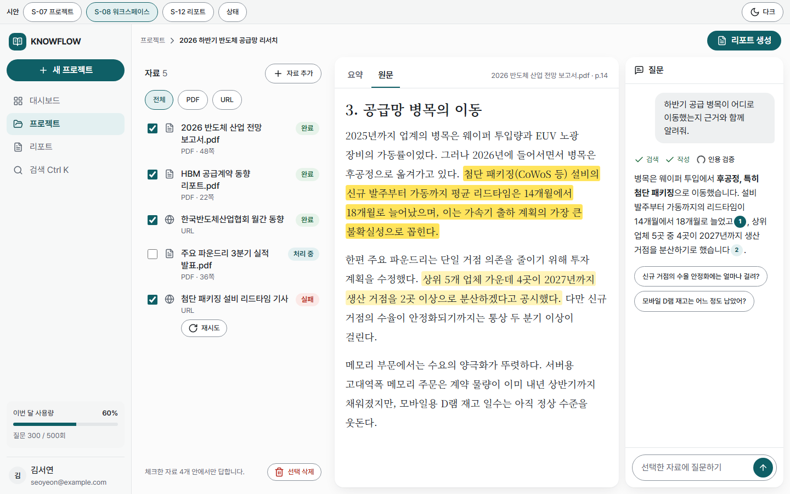
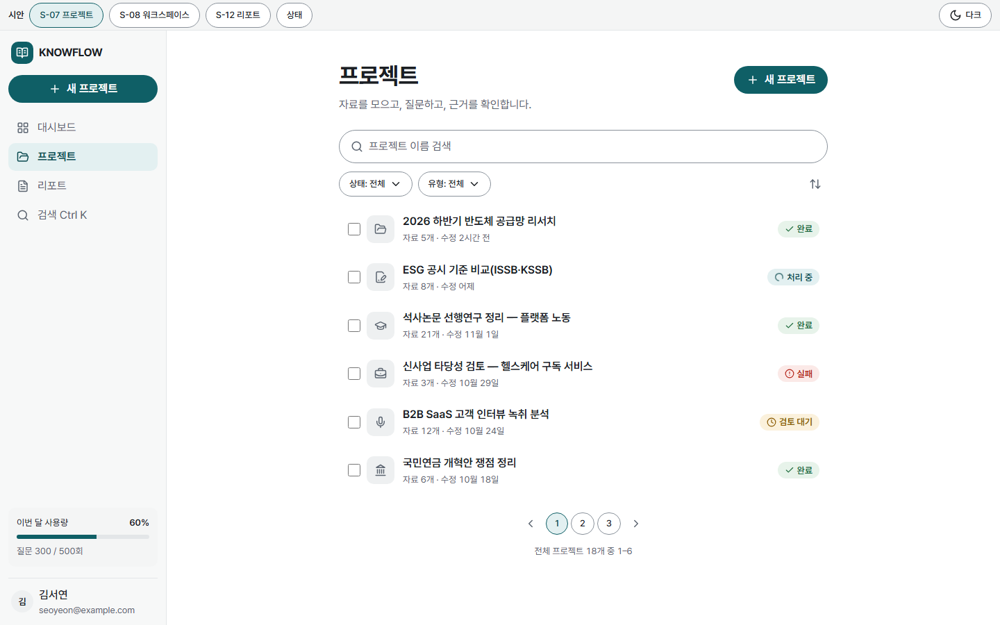

# KNOWFLOW-AI

AI 기반 자료 분석·지식 관리 SaaS. 유튜브 영상 요약과 중요 장면 정리를 최우선으로, PDF와 웹 페이지까지 모아 분석하고, 자료에 근거한 질의응답과 출처가 연결된 리포트를 만든다.

핵심 원칙: Source-grounded AI, Evidence-first, Modular Architecture, Contract-driven Multi-agent Development.

## 화면 미리보기



<sub>S-08 워크스페이스(1440px): 왼쪽 자료 목록, 가운데 원문과 근거 하이라이트, 오른쪽 인용 칩이 붙은 질문 답변. 고해상도 시안(`design/prototype`) 캡처이며 실제 앱 화면이 아니다. 유튜브 요약·장면 카드는 시안 이후 기획이라 아직 들어 있지 않다. 맨 위 알약 줄은 시안 화면 전환용이다.</sub>



<sub>S-07 프로젝트 목록(1440px). 표시된 프로젝트와 사용자는 예시 데이터다.</sub>

## 진행 현황 (2026-11-11 기준)

**기획 단계 완료, 구현 진행 중.** 검증 계획, PRD, 화면·API·데이터 명세, 아키텍처, 디자인 시안, 다이어그램, 작업 분해(32개)가 끝났고 결정 항목은 확정됐다([ADR-0002](docs/adr/0002-mvp-tech-decisions.md)). 2026-11-11 유튜브 요약·중요 장면 캡처를 최우선으로 올렸고([ADR-0006](docs/adr/0006-youtube-summary-and-capture-mvp.md)), 전사·프레임 저장의 법무 확인은 미완료다. 인증·프로젝트·PDF 업로드, 작업 큐·Worker 컨테이너·외부 연결 격리, 인용 검증 기반까지 구현했고 유튜브 품질 측정 도구를 만들었다. 린 검증은 사용자 결정으로 개발과 병행하며, 첫 작업 묶음에서 랜딩 사전예약으로 실행한다.

**지금 사용할 수 있는 것:** 가입·로그인, 프로젝트 만들기, PDF 업로드. **아직 안 되는 것:** 유튜브 요약·장면 카드, 올린 자료의 분석, 질의응답, 리포트. 핵심 기능은 남은 작업 21개에 있다.

| 구분 | 진행률 |
|---|---|
| 전체 프로젝트 | **약 53%** (유튜브 작업 8개 추가로 분모 증가, task-010·032 완료 반영) |
| 기획·설계 구간(01~05단계) | **약 88%** (남은 몫은 작업으로 넘긴 검증 실행·측정 확정) |
| 구현 작업 | **11 / 32 완료 (34.4%)** · task-010 작업 큐·Worker 컨테이너·A-05, task-032 인용 검증 기반까지 완료 |

진행률 근거: 전체는 SDLC 9단계 가중치 × 단계별 완료도 추정값이다(아래 표). 구현부터는 [작업 표](tasks/README.md)의 완료 작업 수로 센다.

제한: 고객·가격은 가정이고, 보안 수치는 베타 초기값(보수적 추정)이다. 린 검증과 베타 사용량으로 조정한다. 유튜브 작업은 Phase 0(task-025)에서 전사 충실도가 미달하면 철회하고, 법무 게이트(task-026) 전에는 수집을 구현하지 않는다. 유튜브 링크만으로 실제 캡처 이미지를 자동 생성하지 않는다.

### 최근 완료 및 진행 중 (2026-11-11)

- 유튜브 MVP 기획([ADR-0006](docs/adr/0006-youtube-summary-and-capture-mvp.md), [검토](docs/youtube-mvp-review.md)): 공개 영상 URL을 Gemini에 넘겨 시각 인용 요약과 장면 카드를 만든다. 서버에서 영상·자막을 내려받지 않는다. task-025~032 신설, 웹 URL 수집(task-009)을 유튜브 뒤로 이동.
- task-010 완료: Worker 컨테이너, CONNECT 프록시 기반 외부 연결 허용 목록(공개 인터넷 기본 거부), 비슈퍼유저 Worker DB 역할, 임대 기한 abort·백오프, A-05 작업 목록·재시도 API와 재시도 자격·분당 한도 RPC.
- task-032 완료: `sources.unavailable_at`, 웹·Worker 공용 인용 검증 패키지 `citations`.
- task-025 진행: 유튜브 Phase 0 측정 도구(`scripts/phase0-youtube`). 실측은 Gemini 키·권리 있는 영상 10편·정답 라벨·판정 기준 승인([결과 문서](docs/youtube-phase0-result.md) 1장) 대기.
- task-011 착수 준비: 사전 검토를 반영한 구현 결정을 [작업 문서](tasks/task-011.md)에 확정. 코드는 아직 없음.
- 이전 완료: task-005 인증, task-007 프로젝트, task-008 PDF 업로드. 실제 Supabase Storage 연동과 반응형 화면 캡처 검증은 남아 있다.

- task-004: Supabase 마이그레이션 6개, 13개 테이블·RLS·기반 RPC·비공개 Storage 버킷 완료.
- `packages/db-tests`에 빈 PostgreSQL에서 마이그레이션과 권한·RLS·쿼터 동시성·멱등성 테스트를 실행하는 하네스를 구성했다. 로컬 실행은 `pnpm test:db`, CI는 PostgreSQL 17 서비스로 검증한다([ADR-0005](docs/adr/0005-db-test-harness-and-queue.md)).
- DB 통합 테스트는 loopback 연결과 `DB_TESTS_ALLOW_RESET=1`을 모두 요구한다. 테스트가 `public`, `auth`, `storage`, `extensions` 스키마를 초기화하므로 전용 테스트 DB에서만 실행한다.

### 개발 단계별 진행률

| 단계 | 가중치 | 완료도 | 기여 | 현재 상태 |
|---|---|---|---|---|
| 01 검증 | 5 | 50% | 2.5 | 가설·검증 계획 완료. 실행은 task-001(랜딩 사전예약)로 개발과 병행 |
| 02 기획 | 10 | 100% | 10 | PRD, MVP 범위, 매체 확장 로드맵, 보안 위협 메모·베타 초기값. 남은 확인은 유튜브 법무(task-026) |
| 03 UX | 10 | 100% | 10 | 화면 17개, 흐름 5개, 상태 정의, 와이어프레임. 필수 구조 누락 0 |
| 04 UI | 10 | 80% | 8 | 토큰·팔레트 A·서체 확정, 핵심 3화면 고해상도 시안. 나머지 화면은 구현 작업에서 토큰으로 제작 |
| 05 기술 설계 | 10 | 90% | 9 | 아키텍처·키 경계, API 11개(A-11은 법무 게이트 조건부), 테이블 14개, ERD, 시퀀스·상태도, ADR 5건. 호스팅(ADR-0003)·임베딩(ADR-0004)은 해당 작업에서 측정 후 기록 |
| 06 구현 | 40 | 34.4% | 13.8 | 작업 11/32 완료(기반·인증·프로젝트·PDF 업로드·작업 큐·Worker 컨테이너·인용 검증 기반) |
| 07 QA | 7 | 0% | 0 | 작업별 리뷰 + task-022·023 |
| 08 배포 | 5 | 0% | 0 | task-024(운영 실행은 사람) |
| 09 개선 | 3 | 0% | 0 | 베타 후 |
| 합계 | 100 | | **53.3** | |

### 작업 진행률 (구현)

| 웨이브 | 작업 | 완료 |
|---|---|---|
| W0 검증 | task-001 | 1 / 1 |
| W1 기반 | task-002~006 | 5 / 5 |
| W2 자료 | task-007~012 | 3 / 6 |
| WY 유튜브 | task-025~032 | 1 / 8 |
| W3 AI | task-013~016 | 0 / 4 |
| W4 리포트·계정 | task-017~020 | 0 / 4 |
| W5 출시 | task-021~024 | 1 / 4 |

### 구현된 주요 항목
- [x] 기획 문서 체계(린 검증 · PRD · 아키텍처 · 화면 · API · 데이터 · ADR)
- [x] 경쟁 제품 벤치마킹(NotebookLM · Readray · Elicit, 매체 비교)
- [x] 디자인 토큰과 고해상도 시안, 다이어그램 구조도
- [x] 작업 분해 24개(문서 리뷰 · 사전 공격 반영)
- [x] 유튜브 MVP 작업 분해 8개(task-025~032)
- [x] 멀티에이전트 개발 환경(NOMAD Agent OS, AGENTS.md)
- [x] 저장소 골격(Next.js 16.4 · Tailwind CSS 4.3 · Vitest · pnpm 작업 공간 · CI · 보안 헤더)
- [x] 랜딩 사전예약 페이지(외부 폼 연결 대기)
- [x] 보안 L1(gitleaks CI·Dependabot·SECURITY.md·커밋 전 훅)
- [x] 앱 셸·공통 컴포넌트(반응형 사이드바·시트·상태·배지·테마)
- [x] 오류·404 화면(내부 정보 비노출)
- [x] DB 마이그레이션·RLS·기반 RPC(task-004)
- [x] 인증·프로젝트·PDF 업로드(task-005·007·008)
- [x] 작업 큐·Worker 컨테이너·외부 연결 격리·A-05 재시도(task-010)
- [x] 인용 검증 공용 패키지·자료 비활성 컬럼(task-032)
- [x] 유튜브 Phase 0 측정 도구(task-025, 실측 전)
- [ ] 유튜브 요약·장면 카드, 자료 추출·검색·질의응답·리포트

### 남은 개발 단계 (권장 순서)
1. **PDF 처리:** task-011 추출·청킹·색인(다음 작업, 법무와 무관) → task-012 자료 목록·원문 뷰어
2. **유튜브 검증:** task-025 실측(미달 시 유튜브 최우선 철회) → task-031 랜딩 문구(예정 기능만) → task-026 법무 게이트
3. **유튜브 구현:** task-027 수집(이때 계정별 API 키 탭 여부 결정) → task-028 공용 청킹 연결 → task-029 요약·장면 카드 → task-030 사용자 승인 화면 캡처
4. **AI 질의응답(W3):** task-013 골든셋·임베딩 확정 → task-014 하이브리드 검색 → task-015 질의응답 → task-016 채팅 화면
5. **리포트·계정(W4):** task-017 리포트 생성 → task-018 리포트 화면·내보내기 → task-019 계정 설정 → task-020 사용량 표시
6. **출시(W5):** task-009 웹 URL 수집 → task-022 E2E·반응형 → task-023 보안 L2 → task-024 베타 배포
7. **QA·배포·개선:** 07~09단계는 4~6이 끝난 뒤 진행한다.

### 사람이 해야 진행되는 일
- [ ] Gemini 키를 `apps/web/.env.local`의 `GEMINI_API_KEY`에 등록, 권리 있는 공개 영상 10편·정답 라벨 준비, 판정 기준 승인(task-025)
- [ ] 변호사 또는 YouTube API 지원팀에 전사·프레임 저장 확인(task-026)
- [ ] 개발용 Supabase 프로젝트 생성(실제 Storage·인증 통합 검증), 요약용 AI 공급자 키 발급
- [ ] 루트 `.env.example`에 `KF_DB_SUPERUSER_PASSWORD`·`WORKER_DB_PASSWORD`·`KF_DB_HOST_PORT` 이름 추가
- [ ] 사전예약 폼 서비스 정하기(preorder.ts 두 줄), GitHub 보안 설정 켜기(docs/security/L2-checklist.md)

## 로컬 개발 및 검증

저장소에 고정된 Node·pnpm 버전은 [AGENTS.md](AGENTS.md)를 따른다. 루트에서 실행한다.

```sh
pnpm install
pnpm dev
```

| 목적 | 명령 |
|---|---|
| 린트·타입 검사 | `pnpm lint` · `pnpm typecheck` |
| 웹 테스트 | `pnpm test` |
| DB 통합 테스트 | `pnpm test:db` |
| Worker 단위 테스트 | `pnpm --filter worker test` |
| 전체 빌드 | `pnpm build` |
| Worker 실행(빌드 후) | `pnpm --filter worker start` |

DB 테스트는 기본적으로 임시 내장 PostgreSQL을 사용한다. 외부 DB를 지정할 때는 위의 전용 테스트 DB 조건을 따른다. Worker 실행에는 `DATABASE_URL`이 필요하며 기본 DB 역할은 `service_role`이다. 연결 정보는 Worker 전용 환경에만 설정한다. `WORKER_DUMMY_HANDLERS=1`은 더미 작업의 상태 전이 검증용이며 실제 자료 처리는 아직 구현하지 않았다.

## 기획 요약

### 무엇을, 누구에게
| 항목 | 내용 |
|---|---|
| 고객(가정) | 한국어 자료를 조사·정리하는 지식노동자(컨설턴트·기획자·대학원생) |
| 문제 | 자료가 흩어져 있고, AI 답변의 근거를 원문에서 다시 찾아 확인하는 데 시간이 든다 |
| 핵심 가치 | 모든 답변·리포트 문장이 자료의 실제 출처로 연결된다. 근거가 없으면 없다고 말한다 |
| 수익 모델(가정) | 월 구독, 사용량(자료 수·질문 수) 한도로 플랜 구분. 가격은 검증 후 결정 |

### MVP 범위
| 기능 | 내용 |
|---|---|
| 계정 | 이메일 가입·로그인·비밀번호 재설정, 계정 삭제 |
| 프로젝트 | 생성·목록, 빈 프로젝트 만들기 안내 |
| 유튜브(최우선) | 공개 영상 요약과 시각 인용, 중요 장면 카드(클릭 시 그 시각부터 재생). 실제 화면 캡처는 법무 확인 후 |
| 자료 수집 | PDF 업로드(여러 개), 웹 URL. 처리 상태 표시와 재시도 |
| 질의응답 | 선택한 자료 범위 안에서 답변, 인용 칩, 코드로 인용 검증, 근거 없음 처리 |
| 리포트 | 출처가 연결된 리포트, 문장별 근거 확인, Markdown 내보내기 |
| 한도 | 요청·자료 처리 쿼터 |

### 매체 확장 로드맵 (추후 예정, MVP에서 개발하지 않음)
| 단계 | 매체 | 인용 위치 |
|---|---|---|
| 확장 1 문서 | 텍스트, Word, PPT, HWP·HWPX, TXT·MD, 스캔 PDF·이미지(OCR) | 페이지·문단·슬라이드 |
| 확장 2 음성·영상 | 오디오, 영상 파일, 팟캐스트 | 시각(mm:ss) |
| 확장 3 연동 | Excel·CSV, Google Drive·Docs, Zotero, ePub | 시트·셀 범위, 페이지 |
| 검토 후 결정 | 실시간 녹음, 로그인·유료 벽 웹페이지 | 시각, 문단 |

데이터는 `source_type` 예약 값과 `locator` 인용 위치로 미리 확장 가능하게 설계했다([ADR-0001](docs/adr/0001-media-expansion.md)).

### 구조
Next.js 웹과 Route Handler가 인증·검증을 맡고, 장시간 처리(추출·청킹·임베딩)는 작업 큐와 Worker로 넘긴다. Supabase(Postgres·RLS·Storage)와 pgvector 하이브리드 검색을 쓴다. 자세한 내용은 [아키텍처](docs/02_ARCHITECTURE.md)와 [다이어그램](docs/diagrams/README.md)에 있다.

### 디자인
Readray(구 Lilys AI)의 정보 배치를 참고했다. 접히는 사이드바, 자료 목록·원문·채팅 3단, 알약형 컨트롤이 그 구조다. 색과 브랜드는 고유하게 정했다. 흰 종이 바탕에 먹색 글자와 청록 강조색을 쓰고, 형광 노랑은 근거 하이라이트에만 쓴다. shadcn/ui 구조와 Tailwind CSS v4 토큰을 쓴다.

## 콘텐츠 바로가기

| 콘텐츠 | 화면 경로 | 기획·명세 문서 | 구현 코드 |
|---|---|---|---|
| 린 검증 | — | [docs/00_LEAN.md](docs/00_LEAN.md) | — |
| PRD | — | [docs/01_PRD.md](docs/01_PRD.md) | — |
| 아키텍처 | — | [docs/02_ARCHITECTURE.md](docs/02_ARCHITECTURE.md) | — |
| 다이어그램 | — | [docs/diagrams/](docs/diagrams/README.md) (기능 맵·사이트맵·UI 구조·시스템 구조·시퀀스·상태도, 단계별 목록) | — |
| 화면·UX | 전 화면 | [docs/03_SCREENS_UX.md](docs/03_SCREENS_UX.md) · [design/wireframes/index.html](design/wireframes/index.html) | — |
| API | — | [docs/04_API.md](docs/04_API.md) | — |
| 데이터 | — | [docs/05_DATA_MODEL.md](docs/05_DATA_MODEL.md) · [ERD](docs/diagrams/03-data-model-erd.md) | — |
| 결정 기록 | — | [ADR-0001 매체 확장](docs/adr/0001-media-expansion.md) · [ADR-0002 MVP 결정](docs/adr/0002-mvp-tech-decisions.md) | — |
| 작업 | — | [tasks/README.md](tasks/README.md) (32개, 웨이브 W0~W5·WY) | — |
| 벤치마킹 | — | [기능](docs/benchmark.md) · [Readray 시각 구조](docs/benchmark-readray.md) · [매체](docs/benchmark-media.md) | — |
| 디자인 | S-07 · S-08 · S-12 | [DESIGN.md](DESIGN.md) · [design/prototype/index.html](design/prototype/index.html) · [design/preview.html](design/preview.html) | [tokens.css](apps/web/src/styles/tokens.css) |
| 청사진 참고 | — | [docs/blueprints/](docs/blueprints/) (NOMAD 모듈, 표 행은 위 문서로 정본화) | — |

## 개발 방식

[NOMAD Agent OS](https://github.com/DevOps0906/nomad-agent-os) 멀티에이전트 팀으로 개발한다. 규칙 정본은 [AGENTS.md](AGENTS.md), 현재 상태는 [tasks/NOW.md](tasks/NOW.md)에 있다. 디자인 공통 기준은 [nomad-design-modules](https://github.com/DevOps0906/nomad-design-modules)를 경로로 인용한다.
