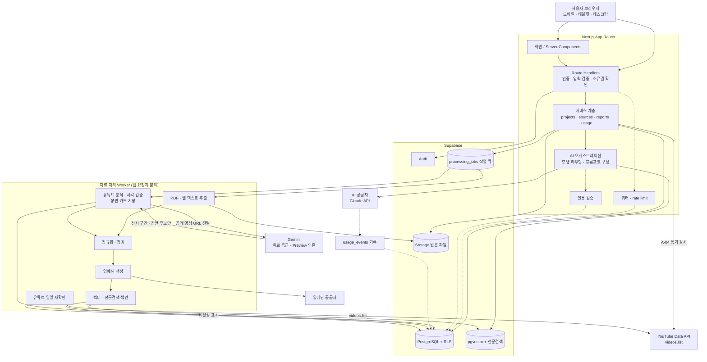

# 01. 시스템 구조도

기준: 개발 기준 문서 v1.0 13장(시스템 구조)에 v1.1 제안(쿼터, 인용 검증, 하이브리드 검색)을 더했다. 점선 표시는 v1.1 제안이다.

## 1. 전체 구성

## 2. 구성 요소 책임

| 구성 요소 | 책임 | 하지 않는 일 |
|---|---|---|
| 화면 / Server Components | 렌더링, 서버에서 인증 상태 확인 | AI 공급자 직접 호출 |
| Route Handlers | 인증, 입력 검증, 소유권 교차 검증, 오류 응답 | 장시간 처리 |
| 서비스 계층 | 프로젝트·자료·리포트 업무 로직, DB 접근 | 클라이언트가 준 user_id 신뢰 |
| AI 오케스트레이션 | 검색, 프롬프트 구성, 모델 라우팅(제안), 사용량 기록 | 근거 없는 출처 생성 |
| 쿼터 · rate limit (제안) | 사용자별 요청·자료 처리 한도 확인 | 결제 처리(MVP 제외) |
| 인용 검증 (제안) | 답변의 인용 ID가 실제 검색된 청크인지 코드로 확인 | 답변 내용의 참 거짓 판정 전부 |
| 작업 큐 + Worker | 추출, 청킹, 임베딩, 색인, 상태 갱신 | 사용자 요청 시간에 묶이는 처리 |
| Supabase RLS | 사용자별 행 접근 제어(2차 방어선) | 서버 검증의 대체 |

## 3. 경계 규칙

| 규칙 | 근거 |
|---|---|
| 서비스 권한 키는 서버와 Worker에서만 쓴다 | 개발 기준 문서 v1.0 16장 |
| 벡터 검색 함수 안에서 project_id 필터를 강제한다 (제안) | 프로젝트 간 검색 결과 격리, 25장 |
| 장시간 작업은 큐로 넘기고 상태를 DB에 남긴다 | 13장, 19장 |
| AI 공급자와 임베딩 모델은 인터페이스 뒤에 둔다 | 13장, 모델 교체 대비 |
| 웹에서 가져온 텍스트는 신뢰하지 않는 데이터로 다룬다 | 19장 프롬프트 인젝션 방어 |

## 4. 미정 항목 (Phase 0 결정 기록 대상)

| 항목 | 후보 | 제안 |
|---|---|---|
| 작업 큐 | Supabase 기반(pgmq 또는 테이블 폴링), 별도 큐 서비스 | MVP는 Supabase 기반이 가장 단순하다 (미확인: 처리량 한도는 착수 시 측정) |
| Worker 실행 환경 | 서버리스 함수, 상시 컨테이너 | 큰 PDF 처리 시간을 측정한 뒤 결정 |
| 임베딩 모델 | 다국어 지원 모델 | 한국어 품질을 골든셋으로 비교한 뒤 결정 |
