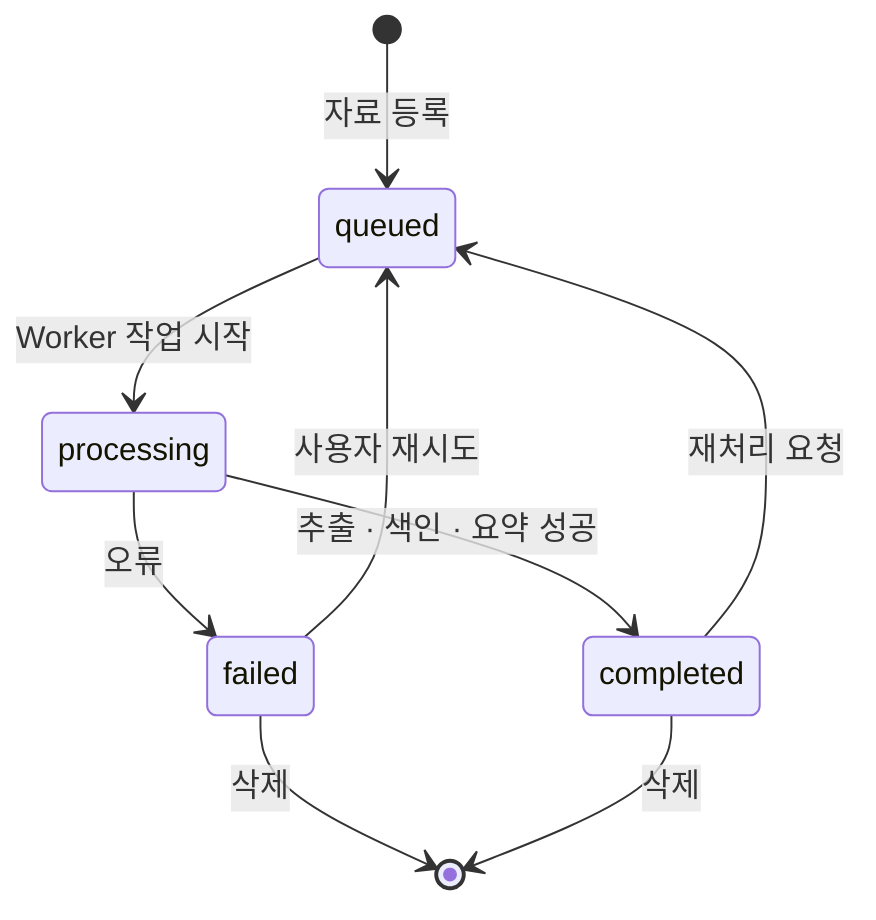
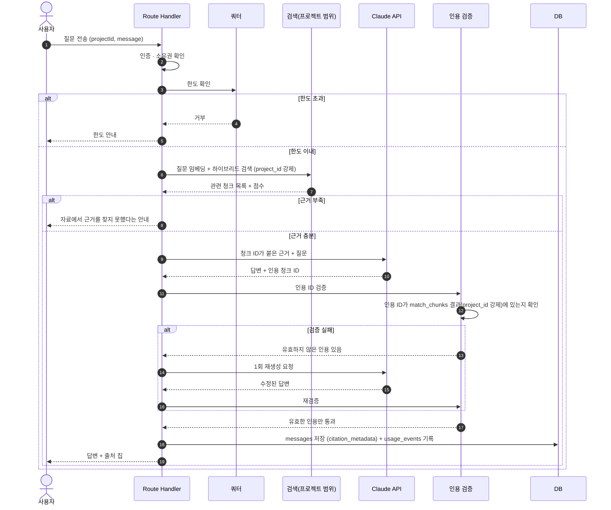

# 02. RAG 처리 흐름과 작업 상태

기준: 개발 기준 문서 v1.0 7장(자료 추가), 17장(RAG 처리 흐름). 하이브리드 검색, 인용 검증, 근거 부족 처리는 v1.1 제안이다.

## 1. 자료 수집 파이프라인

```mermaid
flowchart LR
  in["PDF 업로드 · 웹 URL · 텍스트"] --> val["서버 검증<br/>유형 · 크기 · 권한<br/>URL은 SSRF · 리디렉션 검사"]
  val -->|통과| save["원본 저장<br/>Storage 또는 sources.original_url"]
  val -->|거부| rej["오류 응답<br/>error_code 반환"]
  save --> hash["content_hash 계산<br/>중복 자료 확인"]
  hash --> job["processing_jobs 생성<br/>status = queued"]
  job --> ext["텍스트 추출"]
  ext --> norm["정규화"]
  norm --> chunk["청킹<br/>페이지 · 문단 경계 보존"]
  chunk --> meta["위치 메타데이터 저장<br/>page_number는 실제 확보된 경우만"]
  meta --> emb["임베딩 생성<br/>embedding_model 기록"]
  emb --> idx["pgvector + 전문검색 색인"]
  idx --> sum["자료 요약 · 핵심 내용 추출"]
  sum --> done["status = completed"]
  ext -->|실패| fail["status = failed<br/>error_code + 안전한 메시지"]
  emb -->|실패| fail
  fail --> retry["재시도<br/>attempt_count 관리"]
  retry --> job
  yin["유튜브 URL<br/>공개 영상 1건"] --> ysync["A-04 동기 검사<br/>video_id 추출 · videos.list"]
  ysync -->|거절 사유별 안내| rej
  ysync -->|통과| ydup["중복 판정<br/>project_id, video_id"]
  ydup --> job
  job -->|youtube| ygem["analyze_video · Gemini<br/>공개 영상 URL 전달<br/>전사 구간 · 장면 후보만 수신"]
  ygem --> yts["verify_timestamps · 시각 검증<br/>0 ≤ t < 영상 길이 · 구간 순서 · 중복<br/>위반 구간은 버리고 로그"]
  yts --> ymom["save_moments<br/>장면 카드 source_moments"]
  ymom --> norm
  ygem -->|"실패 · 일시 오류만 재시도"| fail
```

유튜브 자료는 원본 저장·해시 계산 없이 다른 선행 단계를 탄다: [05#4](../05_DATA_MODEL.md), [검토 5장](../youtube-mvp-review.md#5-처리-설계).

## 2. 자료 처리 상태 전이

| 상태 | 의미 | UI 표시 | 비고 |
|---|---|---|---|
| queued | 대기 | 대기 배지(warning) | 업로드 완료는 분석 완료가 아니다 |
| processing | 처리 중 | 진행 표시 | 현재 단계를 보여준다 |
| completed | 완료 | 완료 배지(success) | 질문과 리포트에 사용 가능 |
| failed | 실패 | 오류 배지(error) + 원인 + 재시도 | 스캔 PDF(OCR 필요)는 MVP에서 미지원 안내 (제안) |

유튜브 비활성은 상태값이 아니라 `sources.unavailable_at`이다([05#8](../05_DATA_MODEL.md)).

## 3. 질의응답 흐름 (인용 검증 포함)

## 4. 출처 계약

| 필드 | 설명 | 규칙 |
|---|---|---|
| source_id | 자료 ID | 실제 저장된 자료만 |
| chunk_id | 청크 ID | 검색 결과에 포함된 청크만 인용 가능 |
| source_title | 자료 제목 | 저장된 값 사용 |
| page_number | 페이지 | 실제 확보된 경우만. 없으면 비워 두고 임의 생성 금지 |
| 인용 범위 | 인용 가능한 원문 텍스트 범위 | 원문 클릭 시 위치 표시 |
| t_start · t_end | 유튜브 시각(초) | `locator` 값만. 클릭 시 그 시각부터 재생. 없으면 임의 생성 금지 |
| AI 전사 표시 | 유튜브 청크는 모델 출력 | 코드 검증은 청크 실재만 확인하므로 화면에 "AI 전사"로 표시([검토 5장](../youtube-mvp-review.md#5-처리-설계)) |

## 5. 품질 기준 (v1.1 제안)

| 항목 | 제안 | 비고 |
|---|---|---|
| 하이브리드 검색 | 벡터 검색 + PostgreSQL 전문검색 결합 | 한국어는 벡터 단독이 약할 수 있다. 골든셋으로 비교 후 확정 |
| 청킹 | 페이지 · 문단 경계를 보존하고, 크기와 겹침은 결정 기록에 남긴다 | 수치는 골든셋 실험 후 확정 |
| 골든셋 | 질문 · 정답 · 근거 30~50개 (제안) | CI에서 출처 정확도 측정. 통과 기준 수치는 Phase 0에서 정한다 |
| 인용 검증 | ID 존재, project_id 일치, 인용문이 청크에 포함되는지 | 답변 내용의 모든 주장 입증은 별도 평가 |
