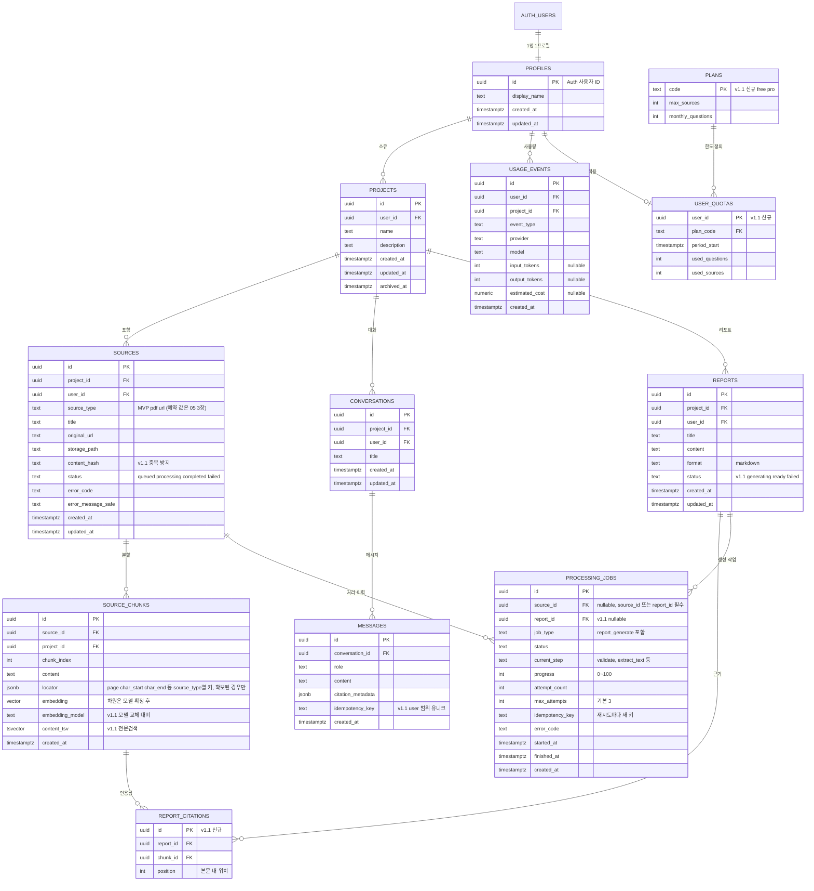

# 03. 데이터 모델 (ERD)

기준: 개발 기준 문서 v1.0 15~16장. v1.1 제안으로 추가·변경한 항목은 2장 표에 따로 정리했다.

## 1. ERD

## 2. v1.0 대비 변경 (v1.1 제안)

| 구분 | 대상 | 변경 | 이유 |
|---|---|---|---|
| 신규 테이블 | report_citations | 리포트와 청크를 정규화해 연결 | v1.0은 출처를 content 안 메타데이터로만 저장해 끊어진 출처를 검사하기 어렵다 |
| 신규 테이블 | plans, user_quotas | 사용자별 한도 | 비용 통제, 무료 한도 초과 시 안내 화면 |
| 컬럼 추가 | sources.content_hash | 같은 자료 중복 업로드 방지 | 중복 비용 방지 |
| 컬럼 추가 | source_chunks.embedding_model | 모델 교체 시 재색인 대상 식별 | 임베딩 모델 미정 |
| 컬럼 추가 | source_chunks.content_tsv | 전문검색 색인 | 하이브리드 검색 |
| 컬럼 변경 | sources.source_type, source_chunks.locator | source_type MVP 값을 pdf·url로 한정(나머지는 예약). page_number·location_metadata를 jsonb locator 하나로 합침 | 매체 확장 대비, 위치 키는 source_type이 정함 (05 3장) |
| 컬럼 추가 | processing_jobs | current_step·progress·max_attempts·idempotency_key 추가 | 단계 표시, 재시도 상한, 중복 실행 방지 (05 1장·JOBS.md) |
| 정책 확정 필요 | 삭제 | soft delete 여부, 벡터·Storage 연쇄 삭제 순서 | 사용자 데이터 삭제 정책 (19장) |

## 3. RLS 원칙

| 대상 | 규칙 |
|---|---|
| 모든 업무 테이블 | user_id가 현재 사용자인 행만 접근. 클라이언트가 준 user_id는 신뢰하지 않는다 |
| source_chunks | 소속 자료가 현재 사용자의 자료일 때만 조회 |
| 벡터 검색 함수 | project_id와 user_id를 함수 안에서 강제 (제안) |
| Storage 경로 | 사용자·프로젝트 단위 경로 정책 |
| usage_events, user_quotas | 사용자는 본인 행 조회만. 쓰기는 서버 |
| RLS 위반 테스트 | CI 필수 게이트 (제안) |

## 4. 미정

| 항목 | 상태 |
|---|---|
| embedding 차원 | 임베딩 모델 확정 후 마이그레이션에 반영 |
| tsvector 언어 설정 | 한국어 형태소 처리 여부는 검색 품질 실험 후 결정 (미확인) |
| usage 비용 필드 | 공급자가 제공하는 범위에서만 채운다. 불완전하면 확정값처럼 표시하지 않는다 |
