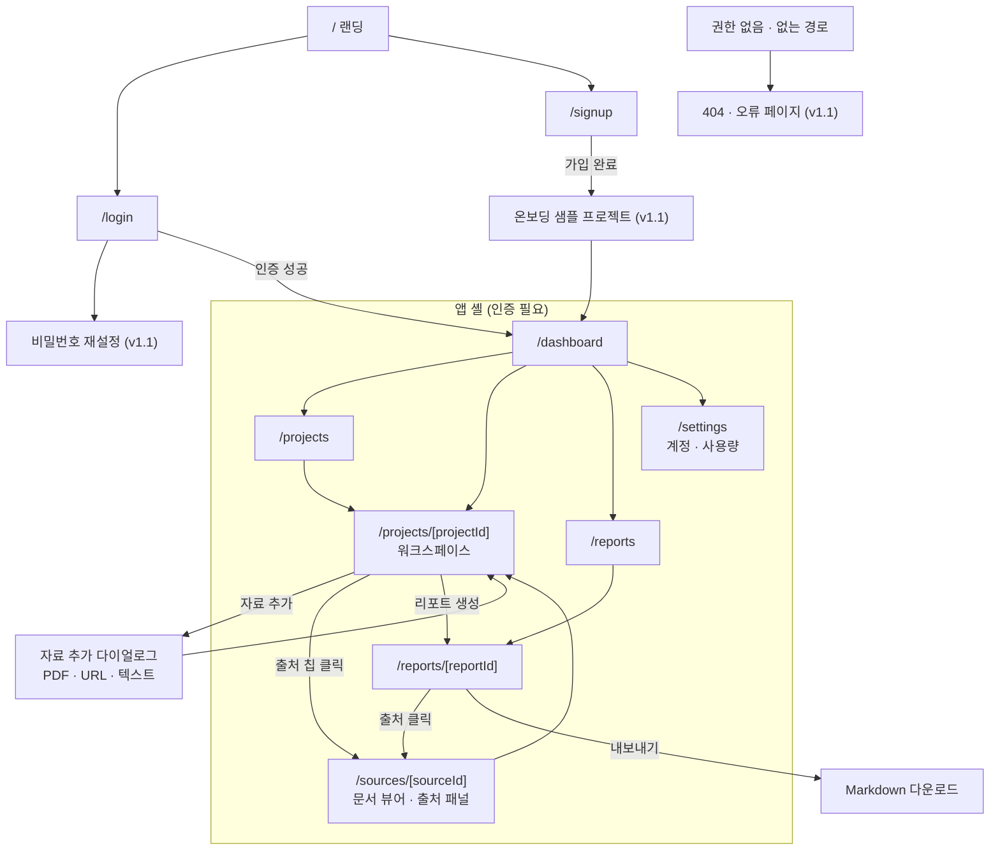

# 04. 화면 이동 구조와 대시보드 레이아웃

기준: 개발 기준 문서 v1.0 KF-DES-001 2~10장. 대시보드 디자인은 Lilys AI의 공개 화면 구조(결과 화면 좌 원본·우 요약, 우측 AI 채팅 패널, 좌측 라이브러리)를 참고하되, 문구·비주얼·내부 구현을 복제하지 않고 이 문서의 자체 구조로 설계한다.

## 1. 화면 이동 구조

## 2. 화면별 구조 패턴과 시각 지정

`nomad-design-modules/_design-guide/DASHBOARD_PATTERNS.md`(구조 A~O)와 `DASHBOARD_VISUAL.md`(시각 V-A~V-N) 표기를 따른다. 값은 제안이며 Gate A에서 확정한다.

| 화면 | 경로 | 구조 | 시각 | 비고 |
|---|---|---|---|---|
| 랜딩 | / | 랜딩 규칙 우선 | V-G | 앱 화면이 아니다. 미구현 기능을 광고하지 않는다 |
| 로그인·가입 | /login, /signup | 고유 | 시각 없음 | Supabase Auth |
| 대시보드 | /dashboard | A, 홈은 "만들던 것을 이어서" 유형(최근 프로젝트 + 새 프로젝트 주 행동) | V-B 일부 | KPI 카드 나열 금지. 처리 중 자료는 목록으로 노출 |
| 프로젝트 목록 | /projects | A + B | V-D | 검색·정렬 상태를 URL에 남긴다 |
| 워크스페이스 | /projects/[id] | A + 3분할 (자료 B / 분석 G / 채팅 AI 패널) | V-L(#53, #54) | 근거(출처) 표시 필수 |
| 자료 추가 | 다이얼로그 | I (단계 분할 가능) | V-K | 업로드 성공과 분석 성공은 별도 상태 |
| 문서 뷰어 | /sources/[id] | A + J 변형(원문 + 인용 패널) | V-L | 페이지 번호를 임의로 만들지 않는다 |
| 리포트 | /reports, /reports/[id] | B → G페이지 | V-D | 블록 편집기·공동 편집은 MVP 제외 |
| 설정·사용량 | /settings | H | 시각 없음 | 섹션별 저장, 비용은 확정값처럼 표시 금지 |

대시보드 시각 규칙 (DASHBOARD_VISUAL.md 6장 적용): 포인트컬러는 화면당 1개, 글로우·그라디언트는 앱 셸에 쓰지 않는다, 숫자는 tabular 숫자로 오른쪽 정렬, 위젯은 화면당 8개 이하, 기본 테마는 라이트(업무·분석 화면)다.

## 3. 벤치마킹 대응표 (공개 구조만)

| Lilys AI 공개 구조 | KNOWFLOW 대응 | 차별점 |
|---|---|---|
| 좌측 사이드바의 프로젝트 라이브러리, 검색 | 앱 셸 사이드바 + /projects 목록 | 서버 검색·정렬을 API 계약으로 정의 |
| 입력 소스 선택(영상, PDF 등) 후 자동 분석 | 자료 추가 다이얼로그(PDF, URL, 텍스트) | 처리 상태 4종과 실패 원인·재시도를 항상 노출 |
| 결과 화면: 원본과 요약 리포트를 나란히 | 워크스페이스 중앙 분석 패널 + 문서 뷰어 | 요약 문장마다 실제 저장된 청크 출처 연결 |
| 목차·출처 번호로 원문 위치 이동 | 출처 칩 → 인용 패널 → 원문 위치 | 인용 검증을 통과한 출처만 표시 |
| 우측 AI 채팅 패널(Lily) | 워크스페이스 우측 AI 채팅 패널 | 프로젝트 범위 검색, 근거 부족 시 명시 |
| 템플릿별 요약 형식, 마인드맵 등 추가 형식 | MVP는 요약·리포트·Markdown. 마인드맵·PPT는 P2 | 범위 확대 시 PRD 변경과 결정 기록 필요 |

## 4. 워크스페이스 반응형 레이아웃

구간: 모바일 ~767px, 태블릿 768~1199px, 데스크탑 1200px~. 기준: [DESIGN.md#2 레이아웃 계획](../../DESIGN.md#2-레이아웃-계획-팀장-결정-구조-근거-docsbenchmark-readraymd). 구간별 다이어그램: [ui-responsive.mmd](ui-responsive.mmd). 앱 셸·S-07·S-08·S-12 배치: [ui-app-shell.mmd](ui-app-shell.mmd). 인용 흐름: [ui-citation.mmd](ui-citation.mmd).

| 항목 | 모바일 ~767 | 태블릿 768~1199 | 데스크탑 1200~ |
|---|---|---|---|
| 앱 사이드바 | Sheet(햄버거 메뉴) | 아이콘만 접힘(SidebarRail) | 좌측 약 17%, 펼침 |
| 워크스페이스 S-08 | 단일 열 원문(②), 채팅은 하단 Sheet | 2단 ②+③, 자료 ①은 Sheet | ResizablePanelGroup 3단 ≈ 30 : 45 : 25 |
| 리포트 S-12 | 단일 열, 목차·출처 모두 Sheet | 목차 접힘, 출처 패널 Sheet | 좌 목차 · 가운데 본문 · 우 출처 패널 |
| 프로젝트 목록 S-07 | 가운데 좁은 단, 행 2줄 | 같음 | 가운데 좁은 단(최대 폭 제한) |
| 터치 영역 | 최소 44px(`--size-touch`) | 최소 44px | 마우스 기준 |
| 페이지 가로 스크롤 | 없음 (표는 자체 스크롤) | 없음 | 없음 |

모바일 하단 탭 3개(자료·분석·채팅)는 폐기한다. 채팅은 하단 Sheet(드로어)로 연다.

## 5. 구간별 글꼴 크기 (제안)

폰트는 Pretendard. 값은 구간별 하한 가독성 기준의 제안이며 Gate A에서 확정한다.

| 요소 | 모바일 ~767 | 태블릿 768~1199 | 데스크탑 1200~ |
|---|---|---|---|
| 페이지 제목 | 22px | 26px | 30px |
| 섹션 제목 | 17px | 19px | 20px |
| 본문 | 14px | 15px | 15px |
| 보조 정보 | 12px | 12px | 13px |
| 버튼 | 14px | 14px | 14px |

v1.0 기준(페이지 제목 28~32px, 섹션 18~22px, 본문 14~16px)은 데스크탑 값으로 유지하고, 모바일·태블릿 값을 새로 추가한 것이다.

## 6. 공통 UI 상태

| 상태 | 요구사항 |
|---|---|
| Loading | 스켈레톤 또는 명확한 진행 표시 |
| Empty | 원인 설명과 다음 행동 CTA |
| Error | 사용자용 메시지와 재시도 가능 여부 |
| Permission denied | 접근 불가 안내, 민감 데이터 비노출 |
| Partial result | 완료·미완료 구분 |
| Processing | 현재 처리 단계 표시 |
| 근거 없음 | 자료에서 근거를 찾지 못했다는 안내 (채팅·리포트) |

## 7. 디자인 결정 (2026-11-02 확정, [ADR-0002](../adr/0002-mvp-tech-decisions.md))

| # | 결정 | 내용 |
|---|---|---|
| 1 | 포인트컬러 | 보라 #5B5BD6 철회(다른 NOMAD 제품과 겹침, AI 보라 안티패턴) → 팔레트 A 청록 #0F5F66 |
| 2 | 기본 테마 | 라이트 기본, 다크는 2차 |
| 3 | 워크스페이스 태블릿 | 2단(원문+채팅), 자료 목록은 시트. 근거 [`ui-responsive.mmd`](ui-responsive.mmd) |
