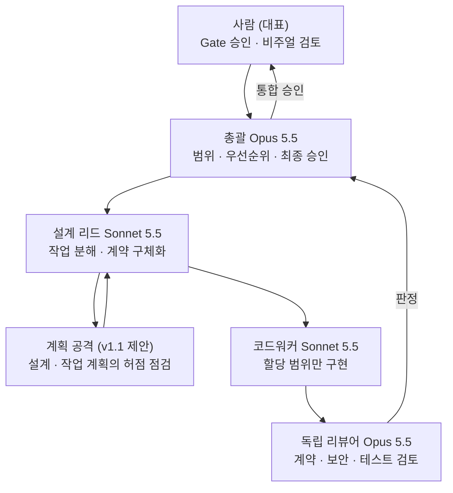
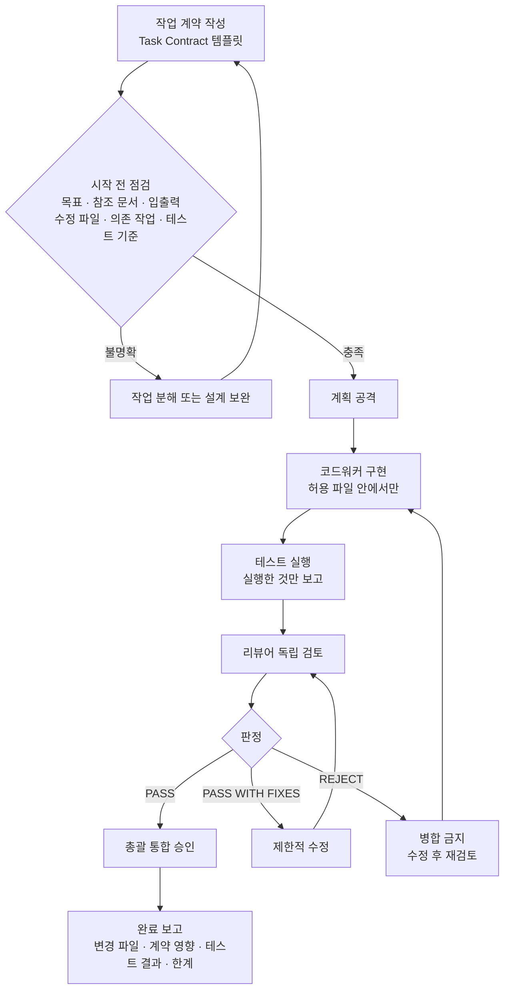
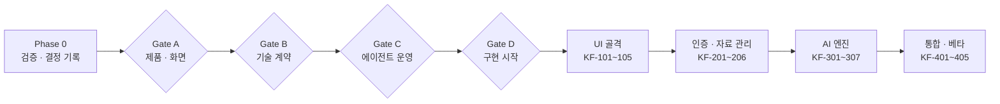

# 05. 멀티에이전트 작업 흐름

기준: 개발 기준 문서 v1.0 KF-AGT-001(20~29장)과 platform-docs README 6장(개발 방법: task 폴더, 웨이브, 계획 공격). 계획 공격 단계는 platform-docs 방식에서 가져온 v1.1 제안이다.

## 1. 역할 구성

| 역할 | 책임 | 금지 |
|---|---|---|
| 총괄 | PRD·MVP 범위 승인, 의존성 관리, 릴리스 게이트 | 승인 없이 범위 확대, 테스트 확인 없이 완료 선언, 보안 REJECT 무시 |
| 설계 리드 | 화면·기술 명세를 작업 계약으로 변환, 파일 범위 지정 | API 계약 조용히 변경, 공유 파일 사전 조정 없이 덮어쓰기 |
| 계획 공격 (제안) | 작업 시작 전 계획의 누락·충돌·위험 지적 | 구현 |
| 코드워커 | 할당 작업 구현, 테스트 작성, 결과 보고 | 임의 프레임워크·DB 추가, 인증·RLS·API 계약 독단 변경, 실행하지 않은 테스트를 통과로 보고 |
| 리뷰어 | 계약 대비 변경, 보안·데이터 접근, 재현 가능한 결함 | 구현자와 같은 세션에서 자기 검토 |

실제 모델 선택, 세션 분리, 병렬 실행 가능 여부는 사용하는 개발 도구의 지원 범위에 따른다.

## 2. 작업 1건의 흐름 (1 작업 = 1 계약 = 1 PR, 제안)

## 3. 승인 게이트와 단계

| 게이트 | 통과 조건 |
|---|---|
| Gate A | 화면별 기능·상태, P0 범위, 디자인 토큰, 반응형 3구간 승인 |
| Gate B | 데이터 모델, API, RLS·Storage 정책, 비동기 처리 방식 확정 |
| Gate C | AGENTS.md, 작업 계약, 파일 소유권, 리뷰 기준 확정 |
| Gate D | 핵심 결정 미해결 없음, Phase 1 수용·테스트 기준 정의, 저장소 문서 존재 |

## 4. 작업 ID 맵

| 단계 | 작업 ID | 담당 | 결과물 |
|---|---|---|---|
| 설계 동결 | KF-000~004 | 총괄, 설계 리드, 리뷰어 | 범위 승인, 화면 명세, 기술·데이터·API 계약, 설계 검수, 동결 승인 |
| UI 기반 | KF-101~105 | 설계 리드, 코드워커, 리뷰어 | 토큰·공통 컴포넌트, 셸·사이드바, 대시보드·프로젝트 목록, 워크스페이스 골격, UI·반응형·접근성 검사 |
| 자료 관리 | KF-201~206 | 설계 리드, 코드워커, 리뷰어 | 인증, CRUD, PDF·URL, 처리 상태, RLS 테스트 |
| AI 엔진 | KF-301~307 | 설계 리드, 코드워커, 리뷰어 | 추출, 청킹, 임베딩, 검색, 채팅, 리포트, 보안 검수 |
| 통합·베타 | KF-401~405 | 전 역할 | 통합 테스트, 오류·재시도, 사용량, 회귀·보안, 출시 승인 |

## 5. 병렬 작업과 파일 소유권

| 규칙 | 내용 |
|---|---|
| 병렬 허용 조건 | 서로 다른 파일을 쓰고 계약이 안정된 경우만 |
| 금지 | 같은 데이터 모델이나 공통 레이아웃을 여러 코드워커가 동시에 수정 |
| 분리 방법 | 병렬 작업은 git worktree로 분리 (제안) |
| 공유 파일 | 설계 리드를 거쳐 조정 |
| 작업 비용 상한 | 작업당 토큰 예산을 계약 템플릿에 추가 (제안, 수치는 Phase 0에서 정한다) |
| 문서 연결 | 계약 변경 시 관련 문서와 docs/DECISIONS.md를 함께 갱신 |

## 6. Claude Code 연동 (제안)

| 항목 | 내용 |
|---|---|
| 지침 파일 | Claude Code는 CLAUDE.md를 읽으므로, CLAUDE.md에서 AGENTS.md를 가져오도록 연결한다 |
| task 폴더 | 작업 1건당 task.md(근거, 쓰기 범위), context.md, log.md(승인·결정 기록) |
| 결정 기록 | 임의로 정한 사항은 log.md에 [DECISION]으로 남긴다 |
